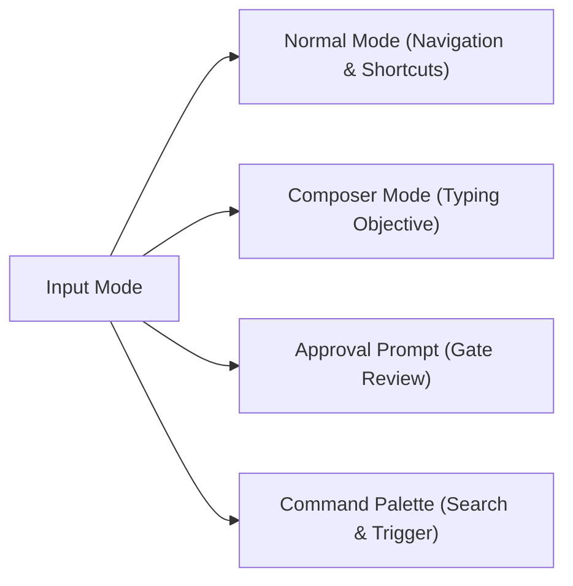

# Codypendent CLI & TUI User Guide

> **Product:** Codypendent — The local-first agentic developer environment
> **Version:** 0.14.0
> **Documentation Target:** CLI reference, Ratatui TUI shortcuts, environment setup, and workflow operations.

---

## 1. Overview & Quickstart

**Codypendent** operates on a client-daemon architecture. Intelligence, state management, git worktree isolation, and session history live within the background daemon process (`codypendentd`), while the user interacts via the **CLI**, the interactive **Ratatui TUI**, or integrated IDE extensions (VS Code, Cursor, Zed).

### Executive Naming Summary
- `codypendent`: Unified CLI and interactive TUI entry point.
- `codypendent daemon`: Management command for the daemon server.
- `codypendentd`: The backend daemon executable.
- `.codypendent/`: Local repository and user configuration directory.

### Quickstart Commands
```bash
# Start an interactive TUI session in the current repository
codypendent
# When startup is ready, press Enter to open the workspace (Esc quits).

# Open a checkout directly from an IDE task or another terminal directory
codypendent -C /path/to/repository
# Long form: codypendent --working-directory /path/to/repository

# Use the cooked, line-oriented accessibility client
codypendent --accessible # --plain is an equivalent alias

# Run an agent with readable streaming output
codypendent run --objective "Fix failing unit tests in crates/runtime" --mode build

# Use JSONL event streaming for scripts
codypendent run --objective "Fix failing unit tests in crates/runtime" --mode build --jsonl

# Validate a multi-agent declarative workflow manifest
codypendent workflow validate path/to/workflow.yaml
```

### Install and upgrade

Release archives contain `codypendent`, the mandatory UI worker launcher, the
sealed Node runtime used by Remote UI, and (when built) the optional standalone
daemon. The unified `codypendent` binary can run its daemon itself.

```bash
# Check without changing the installation.
codypendent update --check

# Install the newest published release, or pin an exact tag.
codypendent update
codypendent update <release-tag>
```

Updating never kills an active run. An idle daemon restarts immediately; a busy
daemon keeps serving its current build until the runs finish or the next
launch. Database migrations are embedded in the binary and apply on open. They
preserve existing sessions and configuration.

> [!WARNING]
> **One published migration file was edited after release, and upgrading from
> the three builds that shipped it fails.** `sqlx` checksums every migration it
> has already applied and refuses to open the database if the file's bytes
> changed, so a migration file is supposed to be immutable once released. That
> promise was broken once, in practice, and it has not been unwound:
>
> | Published build | `migrations/0003_phase2.sql` — file identity (sha256, first 12) |
> |---|---|
> | `v0.1.0-build.42` | `a29143289fa4` (6661 bytes) |
> | `v0.1.0-build.43`, `.44`, `.45` | **`a5c81199c24b` (6828 bytes)** |
> | `v0.1.0-build.46`, `v0.5.1`, and the current 0.14.0 source | `a29143289fa4` (6661 bytes) |
>
> (Verified 2026-08-13 by downloading the file at each published tag and hashing
> it; sqlx's own record is a SHA-384, so these are file identities for
> comparison, not the checksum it stores. The edit was a four-line comment
> clarification — which `sqlx` cannot distinguish from a schema change.) If your
> database was created by **`v0.1.0-build.43`, `.44` or `.45`**,
> upgrading to any later release makes the daemon fail to start with a migration
> checksum error. The current database opener still uses the embedded migration
> history without an automatic repair. Preserve that database and use its
> compatible build until a verified migration path is available; deleting the
> data directory would discard its history.
>
> Schema changes otherwise always ship as a *new* numbered migration.
> `migrations/README.md` explains the immutability requirement; the checksum
> manifest and CI check protect the current history from further edits.

---

## 2. Daemon Management (`codypendent daemon`)

The daemon manages sessions, model routing, database storage, git worktree allocations, and policy enforcement. Commands automatically start the daemon if it is not already running.

```text
codypendent daemon start         # Start the background daemon
codypendent daemon status        # Check daemon status (exit 0 if running, exit 1 if stopped)
codypendent daemon status --json # Output machine-readable JSON status
codypendent daemon stop          # Gracefully shut down the daemon
```

---

## 3. Interactive TUI Reference (`codypendent`)

Running `codypendent` with no subcommands opens the interactive Ratatui terminal user interface attached to the current directory's repository session. Startup finishes on a welcome screen so you can read any diagnostics and confirm the workspace; press `Enter` to proceed or `Esc` to quit.

The welcome screen pairs a linked-agent emblem with a theme-aware block wordmark.
Highlights move during startup and settle when ready, without adding a startup
delay. On smaller terminals, decoration gives way to the current status,
warnings, and Enter prompt; excess warnings are counted and remain available
in Issues.

If no saved profile is runnable, Codypendent opens guided setup after the
splash. Choose a hosted API, local endpoint, or ACP coding agent, then choose a
provider and concrete model. Setup checks the local ports first: when Ollama,
LM Studio or vLLM is answering on its usual port and no hosted key is already
in hand, the "Local endpoint" row is preselected, says which server is
answering, and its picker opens on that server; a server you start while setup
is open is noticed the next time you open `/setup`. `codypendent doctor`
reports the same probe. A saved row is not called ready until the host has
reloaded it into the runnable projection. You may skip setup, but the dialog
states plainly that agent runs cannot start until a runnable model is connected.

During chat, the bottom session strip keeps the most useful durable state
visible. Wide terminals show model/provider, mode and reasoning posture,
context used/remaining, measured usage, permissions, branch/worktree, active and
queued subagents or council members, and integration health. Narrow terminals
prioritize model, mode, context, and agents. Transient notices use a separate
row and do not erase a pending approval, failure, or activity state.

If the daemon connection drops, the status row switches to a persistent
`Connection lost · reconnecting…` state with a running count of seconds, and
the telemetry strip's health field reads `reconnecting`; a run in flight keeps
going on the daemon, and the row clears the moment the session is restored.
While a provider is backing off, the run's activity row reads
`retrying (2/5) · provider is overloaded · next attempt in 8s` — the daemon's
own reason and wait, not a bare counter.

A run that fails shows a failure card whose first line says what kind of
failure it was — an authentication refusal, a rate limit, an unreachable
endpoint — with the sanitized provider response folded underneath. The card's
chips work from the normal view: `Alt-R` retries with the same objective,
`Alt-A` opens the key prompt for that model, `Alt-M` picks another model, and
`Alt-D` disables the failing one. Pressing one with no failed run on screen
says so rather than doing nothing.

The usage field shows only what the provider actually reported for the run —
`1,234 in · 567 out · $0.0034`. Each part is independent: a model that reports
tokens but no price (every unpriced local endpoint) shows its tokens and no
money, rather than a `$0.00` that would read as "this run was free". When
nothing was measured at all the field falls back to the run's cost budget, and
if there is no budget either it renders `—`. A dash means *not measured*, never
*free*.

New run records also carry measurement coverage. A `partial` label means one
or more displayed totals are measured subtotals; some requests or retries have
no measurement. Older records show `coverage unknown`. Small nonzero costs
retain six decimals when four would round them down to zero. Measured zero
remains distinct from missing usage.

Model readiness comes from the running daemon. Passive picker refreshes resolve
configuration and credentials without calling provider endpoints. Explicit
`models check` and key verification ask the daemon to probe the configured
model. ACP validation happens in the agent handshake. An older daemon that
cannot probe models is reported as a compatibility limitation, not a bad key.

The composer reserves at least three visible text rows at normal terminal
heights and grows with Unicode-aware wrapping. Tiny terminals use a compact
layout rather than hiding the send/queue/steer/interrupt state.

### 3.1 Theme Selection & Accessibility

The TUI automatically detects terminal capabilities (`COLORTERM`, `NO_COLOR`, `TERM`), but can be explicitly overridden:

```bash
# Via command line flag
codypendent --theme light
codypendent --theme high-contrast

# Via environment variable
export CODYPENDENT_THEME=color-blind-safe
codypendent
```

#### Supported Built-in Themes:
- `dark` (default dark mode)
- `light` (bright background preset)
- `high-contrast` (accessibility high-contrast palette)
- `color-blind-safe` (Deuteranopia/Protanopia friendly colors)
- `ansi256` / `ansi16` (legacy terminal fallbacks)
- `monochrome` (grayscale / no-color mode)

#### Switching themes while running

Open the command palette with `/` and choose **`/theme`  Theme picker**. It
lists the seven built-in variants plus any data-only theme packs installed
under `<data-dir>/themes/*.toml`. Moving the cursor previews the theme across
the whole interface; `Enter` keeps it, `Esc` goes back to the one in force.

A kept theme is remembered for the next launch. Resolution order at boot is:
`--theme` / `CODYPENDENT_THEME` (an explicit override always wins) → the theme
last kept in the picker → terminal capability detection. A remembered theme
that no longer resolves (an uninstalled pack) quietly falls back to detection
rather than failing the launch.

---

### 3.2 Keyboard & Mouse Parity Reference

Every mouse gesture the TUI recognizes has a keyboard equivalent; the reverse
is not claimed — some keys (steering, run switching, cursor motion) have no
mouse gesture at all, and the table below says so with `-`.

In a browsed patch, `Alt-O` opens the selected file or hunk in the originating
run's checkout and attaches the editor to the same session. It chooses an
installed VS Code, Cursor or VS Code Insiders; set `CODYPENDENT_EDITOR=cursor`
(or `code` / `code-insiders`) to choose one explicitly. The editor confirms the
handoff and honours workspace trust. A deleted file or retired checkout reports
an error without opening the base repository in its place.



#### Complete Hotkey Matrix

The TUI has no permanent buttons, tabs, or toolbars: every surface is either
the conversation, the composer, the one-line footer, or an overlay. The mouse
column below therefore names only the things that actually exist on screen —
rows, chips, and panes you can see. Where it says `-`, the mouse has no
equivalent and the key is the only way in.

| Category | Key | Action | Mouse Equivalent |
| :--- | :--- | :--- | :--- |
| **Navigation** | `F2` | Toggle layout (Chat ⇄ Workspace Panes) | Click the `F2 workspace` footer chip |
| | `Tab` | Cycle focused pane (Workspace layout) | Click a pane |
| | `↑` / `↓` or `k` / `j` | Move selection in list / browser / palette | Scroll wheel |
| | `PgUp` / `PgDn` | Scroll the conversation a page; page Normal-mode browsers and long question cards too | Scroll wheel (3 lines per notch) |
| | `Home` / `End` | Jump to the first / last row of the focused list or browser | - |
| | `Ctrl-↑` / `Ctrl-↓` | Switch to previous / next active run | - |
| | `Alt-↑` / `Alt-↓` | Browse transcript folds (tool cards, diffs, long notes) | Click a fold line |
| | `Alt-Enter` | Expand / collapse the browsed fold, else insert a line break | Click a fold line |
| | `Alt-N` / `Alt-P` | Next / previous hunk in the browsed patch preview | - |
| | `Alt-Shift-N` / `Alt-Shift-P` | Next / previous changed file | - |
| | `Alt-O` | Open the reviewed file or hunk in VS Code / Cursor, with the same session and run checkout | - |
| | `Shift-Enter` | Insert a line break (terminals with enhanced keyboard reporting) | - |
| | `Alt-Y` | Copy the focused transcript card's safe projection | Click the focused card's copy chip, or Shift-drag to select terminal text |
| | `Alt-R` / `Alt-A` | Retry a focused failed run / show re-authentication guidance | Click the corresponding failure-card chip |
| | `Alt-M` / `Alt-D` | Choose another model / open guarded model disable | Click the corresponding failure-card chip |
| **Composer** | `←` / `→` / `Home` / `End` | Move the draft cursor (within its own line) | - |
| | `Ctrl-←` / `Ctrl-→` (or `Alt-←` / `Alt-→`, `Option-B` / `Option-F`) | Move the draft cursor a word at a time | - |
| | `Ctrl-A` / `Ctrl-E` | Jump to the start / end of the draft's current line | - |
| | `Ctrl-W` / `Ctrl-U` / `Ctrl-K` | Delete the word before the cursor / to the line start / to the line end | - |
| | `Option-Backspace` / `Ctrl-D` | Delete the previous word / the character after the draft cursor | - |
| | `Delete` | Delete the character under the cursor | - |
| | `↑` / `↓` | Move between the draft's lines; recall history at its edges | - |
| | `Ctrl-R` / `Ctrl-G` | Search prompt history (older / newer match) | Click a result row in the history popup |
| | `Ctrl-F` | Find in the conversation (newest match first; `Enter` jumps to it) | Click a result row in the search popup |
| | `Ctrl-Z` | Restore the draft that `Esc` just cleared | - |
| | `@` at the start of a word | Mention a file: type to filter, `↑`/`↓` pick, `Enter` inserts the path (an `@` inside a word, such as an e-mail address, is ordinary text; `Enter` with no match sends the message) | Click a row in the file popup |
| | `! command` / `# note` | Run a shell command / save a note to memory instead of prompting | - |
| | `Esc Esc` | On an empty composer: rewind / fork from an earlier turn | Palette row "Rewind / fork from an earlier turn" |
| **Remote UI** | `F6` | Enter the mounted extension document without activating a control | Click extension chrome / the "Extension UI ready" footer |
| | `Shift-F6` | Focus the next mounted extension document | - |
| | `Tab` / `Shift-Tab` | Move through controls across all mounted documents | Click a control |
| | `Enter` / `Space` | Activate the focused extension control | Click the control |
| | `Esc` | Return to the conversation composer | - |
| **Run Control** | `F7` | Open a steering prompt for the selected run; Enter sends immediate steering | Click the `F7 steer` footer chip or palette row "Steer run" |
| | `F8` | Pause / resume the selected run when its state allows it | Click the `F8 pause` / `F8 resume` footer chip |
| | `F9` | Confirm interruption of the named run; later selection changes do not retarget it | Click the `F9 interrupt` footer chip |
| | `Enter` with a live run and a composer draft | Queue the message as a follow-up | Click the composer send chip |
| | `n` / `p` / `c` / `s` in Normal mode | New run / pause or resume / confirmed interruption / steering; printable keys remain text in the composer | Corresponding palette row |
| | `q` | Close a Normal-mode view or browser (never quits); in text filters, including Help, it types `q` | Click outside it, or its `Esc close` chip |
| | `Ctrl-C` | Detach the TUI (the run continues in the daemon) | Palette row "Detach" |
| **Approvals** | `a` | Approve requested action **once** | Click the `a once` footer chip |
| | `A` | Approve requested action **for the whole run** | Click the `A run` footer chip |
| | `p` / `P` | Approve the matching **pattern** / approve for the whole **repository** (when the gate offers those scopes) | Click the corresponding footer chip |
| | `r` | Reject proposed action | Click the `r reject` footer chip |
| **Question cards** | `1`-`9` | Pick (or, with multi-select, toggle) the numbered option | Click the option row |
| | `↑` / `↓`, `Space`, `Enter` | Move the highlight, toggle a multi-select option, confirm | Click an option row / the confirm row |
| | `r` | Open rejection feedback; `Enter` submits the rejection | Click the reject control |
| | `PgUp` / `PgDn` | Page a question body too tall for the modal | Scroll wheel |
| **Studios & Views** | `/` | Open searchable Command Palette | Click the `/ commands` footer chip |
| | `Delete` / `Ctrl-D` in `/model` | Remove the highlighted configured model after confirmation; its provider remains available in `/provider` | - |
| | `S` | Open Skills Studio | Palette row "Skills" (or the `S skills` chip in Memory) |
| | `M` | Open Memory & Knowledge Fabric Browser | Palette row "Memory" (or the `M memory` chip in Skills) |
| | `J` | Open Learning Journey review (activate, reject, pin, edit, or delete curated learning) | Palette row "Learning review" |
| | `C` | Open persisted agent councils (`n` creates, `Enter` runs, `d` removes) | Palette row "Agent council" |
| | `o` | Reveal the focused memory's source | Click the `o source` chip in Memory |
| | `D` | Open Collaborative Docs Studio | Palette row "Docs Studio" |
| | `G` | Open Code Graph Edge Inspector | Palette row "Code graph" |
| | `W`, then `n` | Open the persisted executable Workflow graph; run the selected manifest, or draft an example when empty | Palette row "Executable workflow graph" |
| | `B`, then `n` | Open the workflow Blackboard evidence/decision/artifact stream; post an explicit open question | Palette row "Blackboard evidence stream" |
| | `K`, then `n` | Open the repository Kanban task board; create a task (`←` / `→` moves its column) | Palette row "Kanban task board" |
| | `/theme` | Switch the colour theme (previews live) | Palette row "/theme  Theme picker" |
| | `/setup` | Guided model setup: a hosted API, a local endpoint, or an ACP coding agent. Also opens from `Enter` on an empty composer whenever no configured model can run | Palette row "/setup  Guided setup" |
| | `Ctrl-T` in `/model` or `/keys` | Ask the provider whether the highlighted model answers (the `unverified` badge becomes `ready` or an error) | - |
| | `?` (empty composer) / `F1` | Toggle Help Overlay (`F1` works even mid-draft; `?` in a draft is ordinary text) | Palette row "Help" |
| | `Delete` | Dismiss the selected diagnostic (issues browser) or delete the selected queued prompt | - |
| | `Esc` | Clear draft (`Ctrl-Z` restores it), exit prompt, or close overlay | Click outside an overlay, or its `Esc close` chip |
| **Docs Studio** (with `D` open) | `e` | Edit the focused block | - |
| | `i` | Insert a new block | - |
| | `X` | Delete the focused block | - |
| | `P` | Publish the document (parks an approval showing target + changed files) | - |
| **Remote UI plugins** (with `/plugins` open) | `t` | Enable the focused plugin for this session | - |
| | `u` | Enable the focused plugin for this user | - |
| | `x` | Revoke the focused plugin | - |
| **Councils** (with `C` open) | `d` | Delete the focused council (confirmation) | - |
| | `y` | Copy the focused chair synthesis (same projection as `Alt-Y`) | - |

Every normal-mode key the TUI binds is in this table. The eight rows above the
line — `e`, `i`, `X`, `P`, `t`, `u`, `x`, `y` — were missing from two
consecutive releases of this "complete" matrix, which meant the entire editing
surface of the Docs Studio (`D` sends you there) and the whole plugin
enable/revoke surface were undocumented. Derived from `map_normal_char`
(`crates/tui/src/input.rs`); the overlay-scoped keys are inert elsewhere,
which is why they are grouped by the overlay that gives them meaning.

In Help, type to filter by shortcut, description, or mouse action. Every word
must match, in any order and without case sensitivity. `Backspace` edits the
filter, `Ctrl-W` removes a word, and `Ctrl-U` clears it. Arrow keys, Page Up/Down,
and Home/End scroll the matching rows; `Esc`, `?`, or `F1` closes Help. The
composer draft is preserved. The accessible client supports `type`,
`backspace`, `clear`, and the same navigation through its line commands.

Approval details show the proposed command and working directory, affected
paths, or other action-specific evidence, together with the supplied risk
reasons. GitHub changes include the repository and summary; checkpoint restores
include the commit and worktree that will be reset. If the client cannot
interpret the action type, it explains that limitation and offers rejection
only. Update the client before approving that action.

The front question in the TUI queue owns the answer editor. New questions and
resolutions in the background preserve its draft and scroll position. A reissued
front question starts with fresh answers, including when it has the same number
of prompts or options; previous selections never carry into a new issue. Resolving
the front question opens the next one at the top. To enter a custom answer, move
to the custom-reply row and type.

The prefilled prompt editors (session rename, learning edit, doc-block edit)
share the composer's cursor keys: `←`/`→`, `Home`/`End`, word motion, and the
`Ctrl-W`/`Ctrl-U`/`Ctrl-K` kills all edit at a visible caret rather than
appending at the end. The kills also work inside the palette filter and the
history / conversation search popups.

---

### 3.3 Cooked accessibility mode (`--accessible` / `--plain`)

Use `codypendent --accessible` (or `codypendent --plain`) with a screen reader,
a limited terminal, or redirected stdin/stdout. It stays in ordinary cooked
terminal mode: no alternate screen, raw input, mouse capture, colour escapes,
Unicode chrome, or cursor-addressed redraws. Each change prints a complete,
stable, linear snapshot, including extension-provided accessibility text,
semantic controls, keyboard hints, disabled state, and live-region metadata.

Input is one command per line:

| Command | Effect |
| :--- | :--- |
| Any ordinary line | Send it from the conversation composer |
| `type TEXT` / `send TEXT` | Insert text / insert and submit in the current input surface |
| `help` or `?` | Show the complete command and key reference |
| `f6` / `shift-f6` / `esc` | Enter Remote UI / next document / return |
| `tab` | In Remote UI, move semantic focus forward; otherwise follow the active surface's Tab behavior (ignored by confirmation and approval dialogs) |
| `backtab` | In Remote UI, move semantic focus backward; ignored elsewhere |
| `enter` / `space` | In Remote UI, activate the focused control (`enter` submits or chooses on other input surfaces) |
| `new`, `create`, `run`, `post` | Activate the primary action in a Workflow, Kanban, or Blackboard browser |
| `up`, `down` | Recall composer history, move the current list/approval selection, or forward the semantic key to Remote UI; ignored by text-entry and confirmation dialogs |
| `pageup`, `pagedown` | Page the palette/approval selection or conversation, or forward the semantic key to Remote UI; ignored by text-entry and confirmation dialogs |
| `home`, `end` | Move to the first/last palette item, move within a composer line, or forward the key to Remote UI |
| `delete` | In `/model` or `/keys`, open the highlighted item's removal confirmation; in Remote UI, forward the semantic Delete key |
| `copy` / `alt-y` | Copy the selected council synthesis or focused transcript card; cooked mode prints a sanitized fallback when no clipboard is available |
| `alt-r`, `alt-a`, `alt-m`, `alt-d` | Retry, show re-authentication guidance, choose a model, or open guarded disable for the focused failure card |
| `yes`, `no` | Confirm or cancel the open confirmation dialog. Only where a dialog owns the input — in the composer and other text surfaces they are ordinary words and are sent as written |
| `approve`, `approve-run`, `reject` | Resolve the selected approval |
| `quit` | Detach; the daemon keeps active runs alive |

`COLUMNS` and `LINES` set the viewport advertised to extension components;
defaults are `80` by `24`.

The cooked client derives focus order, form fields, activation targets, and
keyboard actions from the same validated Remote UI document as the full-screen
renderer. `F6` therefore enters an operable extension surface rather than a
text-only transcript: focus, editing, and activation remain semantic and never
depend on mouse coordinates or cursor-addressed terminal output.

Confirmation and approval dialogs own their input just as they do in the
full-screen client. Cooked `type`, `send`, navigation, and editing commands that
the active dialog does not support are ignored or reported as unrecognised;
they never edit or submit a composer hidden behind the dialog.

---

## 4. Command-Line Interface (CLI) Reference

### 4.1 Headless Execution & Event Attaching

Run agents headlessly with readable answers, or stream events into JSON pipelines:

```bash
# Stream the answer to stdout, with progress and diagnostics on stderr
codypendent run \
  --objective "Add unit tests for workspace.read_file" \
  --mode build \
  --repo /path/to/repo

# Preserve the full event-envelope stream for automation
codypendent run --objective "Explain the test failures" --jsonl > events.jsonl

# Attach to an existing session from a specific event sequence cursor
codypendent attach <SESSION_ID> --from-sequence 42 --events jsonl
```

Readable output contains answer text from the run this command started; private
thought deltas and concurrent runs in the same session are omitted. If no answer
was streamed, the completion summary is printed when available. Terminal control
sequences are stripped from readable output. `--jsonl` (also `--json`) preserves
the complete subscribed event stream and its existing envelope format.

Both output modes return `0` for completion, `2` for a failed run, and `130` for
cancellation. `Ctrl-C` detaches the client while the daemon continues the run.
Measured usage appears on stderr too: `1,200 in · $0.000011 · partial`.
Missing dimensions are omitted, measured zero remains zero, and older events
without completeness metadata say `coverage unknown`. Redirecting stdout keeps
just the answer. A bounded compatibility drain retains usage that older daemons
send immediately after completion.

In readable mode, the session ID and reattach command appear on stderr. When a run needs an
approval or answer, open that session in the TUI or desktop to respond.

Session and bundle exports write verified files:

```bash
codypendent session export <SESSION_ID> --out transcript.md --format markdown
codypendent bundle export --out support.tar --session <SESSION_ID> --include-transcripts
```

Downloads stream in bounded chunks to a private temporary file beside the
destination. The client verifies artifact identity, length, and SHA-256 before
replacing an existing file. Interrupted, incomplete, or corrupt downloads leave
the previous export intact. Parent directories are created as needed, and a
relative filename such as `--out transcript.md` works. The TUI Session Library
uses the same transfer and verification path. Artifact bodies and internal
sessions remain opt-in for session exports.

### 4.2 Declarative Workflows (`codypendent workflow` & `codypendent fix-ci`)

Manage multi-agent declarative workflows and automated repairs:

```bash
# Repair a failing GitHub Actions check on a pull request (/fix-ci)
codypendent fix-ci --pr 482

# Validate workflow YAML structure and cross-check agent profiles
codypendent workflow validate workflows/ci-fix.yaml --agents .codypendent/agents

# Inspect compiled workflow graph as JSON or tree
codypendent workflow show workflows/ci-fix.yaml --json

# Start a durable workflow run
codypendent workflow run workflows/ci-fix.yaml --inputs '{"pull_request": 482}'

# Pause, resume, or retry workflow runs
codypendent workflow pause <WORKFLOW_RUN_ID>
codypendent workflow resume <WORKFLOW_RUN_ID>
codypendent workflow retry <WORKFLOW_RUN_ID> --node "fix_step"

# Cancel or watch live node transitions of a workflow run
codypendent workflow cancel <WORKFLOW_RUN_ID>
codypendent workflow watch <WORKFLOW_RUN_ID>
```

### 4.3 Plugin Security & Governance (`codypendent plugin`)

Inspect plugin manifests, audit permission expansions, verify ed25519 signatures, and manage trusted publishers:

```bash
# Inspect plugin capabilities, resource caps, and trust posture
codypendent plugin inspect path/to/plugin.toml

# Compare installed plugin against an update to detect permission expansions
codypendent plugin diff installed.toml update.toml

# Verify plugin artifact against manifest using trusted publisher key store
codypendent plugin verify manifest.toml artifact.tar.gz [--allow-unsigned]

# Install inert, exercise the production sandbox, then enable explicitly
codypendent plugin install plugin.toml package.cody-ui.tgz
codypendent plugin smoke-test <PLUGIN_ID>
codypendent plugin enable <PLUGIN_ID> --scope user
codypendent plugin enable <PLUGIN_ID> --scope session --session <SESSION_ID>
codypendent plugin list

# Stage an update; expanded permissions return an exact one-shot receipt
codypendent plugin update <PLUGIN_ID> plugin.toml package.cody-ui.tgz
codypendent plugin approve-update <PLUGIN_ID> <APPROVAL_RECEIPT>
codypendent plugin reject-update <PLUGIN_ID> <APPROVAL_RECEIPT>

# Immediately revoke authority and terminate active workers
codypendent plugin revoke <PLUGIN_ID>

# Manage trusted publisher ed25519 public keys
codypendent plugin trust add <PUBLISHER_ID> <BASE64_PUBLIC_KEY>
codypendent plugin trust list
codypendent plugin trust remove <PUBLISHER_ID>
```

`install` never enables code. `smoke-test` performs the framed worker handshake
inside the real sandbox. An update receipt is sealed to the candidate artifact,
publisher key, permission diff, and previous lifecycle state; it cannot approve
a different package. Secret entry and approval decisions remain host-owned even
when a plugin supplies explanatory UI.

### 4.4 Documentation Publishing (`codypendent docs`)

Publish collaborative CRDT documents to Git targets through approval-gated write paths:

```bash
# Publish a document to a repo file, dedicated docs branch, or documentation PR
codypendent docs publish <DOCUMENT_ID> --target repo-file --path docs/guide.md -y
codypendent docs publish <DOCUMENT_ID> --target doc-pr --title "Docs update"
```

### 4.5 Model Benchmarking, Evaluation & Promotion (`codypendent eval`, `models`, `promote`)

The built-in catalog `codypendent models list-providers` reads ships **386**
curated `[[model]]` rows
<!-- doc-count:match sources="crates/providers/builtin_catalog.toml" pattern="^\[\[model\]\]$" expect=386 label="curated model rows" -->
across **39** providers
<!-- doc-count:match sources="crates/providers/builtin_catalog.toml" pattern="^\[\[provider\]\]$" expect=39 label="catalog providers" -->
(both re-derived from `crates/providers/builtin_catalog.toml` on every PR by
`.github/scripts/check_doc_test_counts.py`, so they cannot go stale here).
Live `/models` discovery is merged on top when a provider offers a listing
endpoint.

Benchmark local models, run evaluation suites, and drive learnable artifacts through human-gated promotion:

```bash
# Benchmark a local model in models.toml and record measured performance
codypendent models bench qwen2.5-coder-32b

# Execute an evaluation suite against a routing policy and produce a JSON report
codypendent eval run --suite core --policy coding-balanced --report report.json

# Draft and advance candidates through promotion pipeline (no self-promotion allowed)
codypendent promote propose --kind router --name tool-selection --version 2
codypendent promote advance <CANDIDATE_ID> --step regression
codypendent promote approve <CANDIDATE_ID> # Requires human operator approval
codypendent promote rollback <CANDIDATE_ID> # Roll back to predecessor version
```

### 4.5.1 Local models via Unsloth

Codypendent can browse the [Unsloth](https://huggingface.co/unsloth) org's
GGUF catalog on Hugging Face, pull a quant through
[Ollama](https://ollama.com), and register it as a selectable local model —
and, separately, scaffold a QLoRA fine-tuning project for the same family of
base models. **Honesty first:** Codypendent itself needs neither a GPU nor
Ollama to run; both of the flows below shell out to binaries you install
yourself (`ollama` for pulling, a CUDA-capable Python environment for
fine-tuning), and every command degrades to an actionable error — never a
silent failure or a fabricated result — when they're missing.

```bash
# Resolve unsloth/Qwen3-32B-GGUF, auto-pick a quant (Q4_K_M if present, or
# the repo's only quant; otherwise it lists the choices instead of guessing),
# drive `ollama pull` with streamed progress, and register the result
codypendent models pull Qwen3-32B-GGUF

# Pin an exact quant, or pull from outside the unsloth org
codypendent models pull Qwen3-32B-GGUF:UD-Q4_K_XL
codypendent models pull some-org/Some-Model-GGUF:Q8_0
```

`models pull` registers the pulled model in `models.toml` against the
`ollama` provider using the **exact reference Ollama itself uses**
(`hf.co/<org>/<repo>:<quant>` — what `ollama list` shows, and what the
OpenAI-compatible `model` field must match at call time), carrying
`context_tokens` from the repo's Hugging Face metadata when the Hub reports
one. It prints a `codypendent models bench <id>` suggestion afterward so the
router gets a measured profile, exactly like any other freshly-added local
model. Requires `ollama` on `PATH`; a missing binary fails with an
`install it from https://ollama.com` message rather than a bare error.

The TUI offers the same catalog browse through the command palette. Press
`/`, select **Local models: browse Unsloth catalog**, and step through:

1. **Repos** — a fuzzy-filterable list of the org's GGUF repos (downloads,
   likes, last updated), fetched live from the Hub.
2. **Quants** — for the chosen repo, every quant variant parsed from its file
   tree (including Unsloth's dynamic `UD-` quants and multi-part split
   files), each with its combined download size.
3. **Confirm** — a yes/no prompt naming the exact `ollama pull` reference and
   its download size before anything downloads.
4. **Progress** — live `ollama pull` output, then a registered-model notice
   (or the failure, verbatim) once it finishes. Closing this view with `Esc`
   does not cancel the pull — it keeps running detached, the same way a
   dismissed model-discovery query does.

```bash
# Scaffold a standalone Unsloth QLoRA fine-tuning project (pinned
# requirements, a train.py for the base model, a JSONL dataset stub, and a
# README covering GPU requirements, training, GGUF export, and `ollama
# create`). Refuses if the target directory already exists.
codypendent finetune init
codypendent finetune init --model unsloth/Qwen3-8B-unsloth-bnb-4bit --out my-finetune

# Verify Python and CUDA are present on THIS machine before training there.
# A missing GPU only warns (the scaffold is still useful without one); a
# missing Python interpreter fails.
codypendent finetune check

# Seed dataset/train.jsonl from the repo's own session/eval history, where a
# clean seam exists to do so. Today it prints exactly why that seam doesn't
# exist yet (a daemon-side transcript-reconstruction API the CLI can't reach
# read-only) instead of silently producing nothing.
codypendent finetune dataset export
```

The scaffolded project is entirely separate from Codypendent's own build:
`train.py` is a normal Unsloth QLoRA script you run yourself, on a machine
with an NVIDIA GPU. Once you've exported a GGUF and run `ollama create` on
it (both covered in the scaffold's own `README.md`), add the result to
Codypendent the same way as any other local Ollama model — via the
`/model`/`/provider` picker, or a hand-written `[[model]]` entry in
`models.toml` — then `codypendent models bench <id>` to measure it.

### 4.6 IDE Integration, ACP Agents & Handoff (`codypendent open` / `acp`)

```bash
# Open an ongoing TUI session inside VS Code, Cursor, or Zed
codypendent open <SESSION_ID> --in vscode
codypendent open <SESSION_ID> --in cursor
codypendent open <SESSION_ID> --in zed

# Discover all agents in the curated official ACP registry
codypendent acp list --refresh

# Install, handshake, and add Claude Code or Codex to the model picker
codypendent acp connect claude-acp
codypendent acp connect codex-acp
# Friendly product names are accepted too:
codypendent acp connect claude-code
codypendent acp connect codex

# Other registry agents work through the same flow (Gemini, OpenCode, Goose,
# GitHub Copilot CLI, Cursor, Cline, Qwen Code, and the complete registry)
codypendent acp connect gemini
codypendent acp connect kimi-code
codypendent acp connect amp
codypendent acp connect vibe-chat       # official id: mistral-vibe
codypendent acp status

# Send a real session/prompt compatibility check; every tool request is denied
codypendent acp probe codex

# Remove a selectable profile without deleting the shared download cache
codypendent acp disconnect acp/codex-acp

# Serve Codypendent itself as an ACP (Agent Client Protocol) agent for Zed
codypendent acp --repo /path/to/repo
# Equivalent explicit spelling:
codypendent acp serve --repo /path/to/repo
```

`acp status` verifies that the saved launch coordinate can be resolved; it does
not prove that the vendor's own login is current. Use `acp probe` for a real
session/prompt check. If Cline reports that it requires re-authentication,
complete Cline's normal sign-in flow in a terminal and retry the focused TUI
failure with `Alt-R`; `Alt-A` shows the same guidance without reading or storing
the vendor credential.

The registry is discovered from ACP's curated v1 endpoint on first use, cached
under the Codypendent data directory, and refreshed automatically after 24
hours (with a validated stale-cache fallback when offline). NPM and Python
distributions are launched at the exact version in the registry. Platform
archives are installed only on an
explicit `install`/`connect`, are SHA-256 verified when the registry supplies a
digest, and are extracted with traversal, link, duplicate-path, entry-count,
and size limits. An entry without a digest requires the explicit
`--allow-unverified` acknowledgement.

Known native ACP servers are also detected without replacing the curated
catalog. In particular, `~/.kimi-code/bin/kimi` (or a `kimi` on `PATH`) appears
as `kimi-code`, launches `kimi acp`, shares the credentials created by
`kimi login`, and pins the executable's bounded `--version` result. Installed
Junie (`junie --acp=true`), Cursor CLI (`cursor-agent acp`), Cortex Code,
Corust Agent, Crow CLI, Devin, and Stakpak are detected the same way when their
documented ACP executable is already on `PATH`. This makes official-registry
entries usable without weakening the checksum rule for downloaded archives.
The older official `kimi` registry entry remains separately addressable as
`kimi-cli`.

Google Antigravity does not currently ship a native ACP server. Codypendent can
use the third-party `antigravity-acp` bridge, but never downloads it merely
because the provider catalog was opened. Selecting it in `/provider` presents a
host-owned confirmation explaining that the bridge is not provided or endorsed
by Google and that its maintainer warns third-party Antigravity OAuth use may
violate Google's Terms of Service and risk account suspension. Only `y`/Enter
continues. Codypendent then downloads the pinned v1.0.0 platform binary from the
bridge's GitHub release, verifies its published SHA-256, installs it privately,
and opens the normal live ACP model selector. An explicitly installed
`agy-acp`/`antigravity-acp` on `PATH` still takes precedence and is never
replaced. The equivalent non-interactive command requires the warning-specific
acknowledgement:

```bash
codypendent acp connect antigravity --accept-community-risk
```

Review Google's terms and the bridge source before opting in. Codypendent does
not read or store Antigravity credentials.

Discovery tracks the latest catalogue, but connecting snapshots an immutable
`agent-id@version` coordinate into the model profile. A daily registry refresh
can reveal a newer client without silently upgrading an agent used by an
existing run; reconnect explicitly when you want to adopt the new version.

Each agent keeps its own normal authentication flow. Sign in to Claude Code,
Codex, Kimi, Amp, Mistral Vibe, or the relevant vendor CLI as required; the ACP
handshake verifies protocol compatibility but does not copy or persist vendor
credentials in Codypendent.

ACP profiles appear in `/model` alongside native model endpoints. During a run,
the external agent owns its model and tool loop; Codypendent still owns the
worktree allocation, durable transcript, approval UI, cancellation, diff
review, chronicle, and terminal state. Build-mode runs receive an isolated
worktree; read-only modes use the selected repository without granting
Codypendent write authority. The process remains a trusted local vendor
executable with the normal OS authority of your user account. ACP permission
requests are therefore resolved through the same host-owned approval queue as
native tools, but that cooperative protocol boundary is not an OS sandbox.

### 4.6.1 Multi-provider agent councils

Councils let native models and connected ACP agents deliberate together. A
definition contains 2-8 distinct configured model profiles, a role for each,
one configured chair profile, and 1-3 rounds. Round one produces independent
reports in parallel. Later rounds receive the council's **board** — every round
so far, attributed and bounded, including the chair's rulings — and are
explicitly asked to challenge it. The chair then reconciles evidence,
uncertainty, and dissent into the final answer.

A member's role is both a **lens** (what it knows about: `security`,
`delivery`) and a **stance** (how it is obliged to work). Most roles take the
default deliberating stance; a role naming one — `security reviewer`, `red
team`, `adversarial` — is held to that stance's duties instead. Every role,
chair included, carries the same non-negotiables: absence over invention,
evidence over assertion, say exactly what is true, and disagreement over silent
compliance.

Between rounds the chair issues a **ruling**: what the round settled, what
remains open, and what the next round must resolve. When the rounds are done
and the chair has synthesized, an **independent reviewer** — never the chair —
reads the whole council under instructions to trust none of it, and reports
what the deliberation came to take for granted. In evidence mode it gets the
same read-only access the members had, so it can check a citation rather than
accept it. Reviews are on by default; set `review = false` in `councils.toml`
to opt out, or `reviewer = "<model>"` to name one explicitly. **A synthesis
that was not reviewed is labelled `UNREVIEWED`** rather than being presented
silently.

A member that runs out of time keeps whatever it had produced: the text is
preserved on the board under its own name, marked `UNFINISHED`, and does not
count toward quorum.

```bash
# MODEL=ROLE; repeat --member for every participant.
codypendent council create release-board \
  --member acp/claude-acp=maintainer \
  --member acp/codex-acp=security-critic \
  --member acp/kimi-code=researcher \
  --chair acp/amp-acp \
  --rounds 2 \
  --description "Independent release review"

codypendent council list
codypendent council show release-board
codypendent council result release-board
codypendent council result <COUNCIL_RESULT_ID> --json
codypendent council run release-board \
  --objective "Should this change ship, and what must be fixed first?"
codypendent council run release-board --objective "..." --json
codypendent council remove release-board
```

Council runs use `Ask` policy by default, tell members not to invoke tools or
modify files, and require a quorum of completed member reports in every round
(a simple majority unless `quorum` says otherwise). In evidence mode members
and the independent reviewer run `Explore` instead — policy-enforced read-only
tools — and are asked to cite `file:line` and to state what they did not read. Each member
and the chair receives its own durable session/run, with the selected profile
pinned explicitly. A failed participant is reported; a surviving quorum may
continue. Responses, dossiers, concurrency, rounds, and time are bounded.
`councils.toml` is written atomically with user-only permissions.

Agent-initiated `council.create` and `council.run` calls always require a fresh,
non-reusable approval because they change durable configuration or fan out paid
model requests. Member reports are untrusted input: the chair prompt frames
each report as evidence rather than instructions, and a retrieved synthesis is
again labeled before another model consumes it. Every attempt receives a stable
result id and persists completed member work even when quorum or the chair fails.

The normal TUI includes the same creation flow. Press `/`, select
`/council  Agent council`, and complete these **seven** pages
(`CouncilBuilderStep`, `crates/tui/src/state.rs` — this guide used to number
four, so page 5 of 7 looked like the end of a flow that had ended):

1. **Name** — a stable council name.
2. **Description** — an optional purpose.
3. **Member model** — pick a configured model profile. Provider names and
   readiness are shown beside models.
4. **Member role** — enter that member's role. Pages 3 and 4 repeat until 2-8
   unique members are present.
5. **Chair** — select the synthesis chair.
6. **Rounds** — choose 1-3 deliberation rounds.
7. **Review** — the complete definition; press Enter to create it.

`Esc` moves back one page without discarding the draft (and closes from the
first page). The final write is performed by the CLI host through the same
validation and private atomic store as `codypendent council create`; the TUI
renderer itself never performs filesystem I/O.

### 4.7 Learning Journey (`/journey`)

Press `J` or choose `/journey  Learning review` in the palette. This surface is
separate from the legacy Memory browser: it contains compact, governed facts or
procedures that can improve a future run without retaining the whole transcript.

| Key | Effect |
| :--- | :--- |
| `a` | Activate a reviewed proposal |
| `r` | Reject it while retaining the audit record |
| `p` | Pin or unpin the selected learning |
| `e` | Edit through the same secret and quality policy as capture |
| `d` | Open permanent-delete confirmation |

Automatic capture accepts only explicit user preferences/corrections and a
small allow-list of local verification commands that actually succeeded.
Untrusted repository text, model inference, council synthesis, tool output, or
external content can never auto-activate a learning. Greetings, generic run
receipts, raw logs, temporary paths, URLs, and secret-shaped text are rejected.
Every record carries scope, provenance, confidence, lifecycle state, expiry,
and an optimistic revision so concurrent edits fail rather than overwrite.

### 4.8 Knowledge Index Maintenance (`codypendent index`)

```bash
# Rebuild the derived RETRIEVAL indexes (full-text BM25 + vectors) from the
# authoritative SQLite rows.
codypendent index rebuild
```

This command does **not** rebuild the tree-sitter code graph, and running it
will not fix stale `graph.*` answers. The code graph
(`code_nodes`/`code_edges`) is scanned per repository when you open a session
or start a run. `codypendent index --help` says the same thing; if the two ever
disagree again, the `--help` text is the one derived from the code.

---

## 5. Voice (Speech-to-Text & Text-to-Speech)

Voice is **optional and off by default**. Turning it on takes two things
Codypendent deliberately does not ship: a **recorder binary** already on your
machine, and an **API key for a speech provider**. Nothing below works without
them, and nothing below is enabled implicitly.

> [!WARNING]
> Voice was developed and tested on a machine with **no audio hardware**. The
> request shapes, configuration handling, classification gate, and every failure
> path are covered by tests (mock HTTP servers and fake recorder/player
> commands), but **no part of the capture or playback path has been exercised
> against a real microphone or speaker**. Treat your first recording on real
> hardware as unverified, and expect to tune `record_command` for your device.

### 5.1 Configuration

All of voice lives in three optional tables in `<data_dir>/models.toml`,
alongside your `[[model]]` entries:

```toml
# Speech-to-text: what your voice notes are transcribed with.
[transcription]
base_url = "https://api.groq.com/openai/v1"
model = "whisper-large-v3-turbo"
api_key_env = "GROQ_API_KEY"
# local = true    # set ONLY for an on-device engine (see 5.4)

# Text-to-speech: what reads replies aloud. Optional.
[speech]
base_url = "https://api.openai.com/v1"
model = "gpt-4o-mini-tts"
voice = "alloy"
format = "mp3"
api_key_env = "OPENAI_API_KEY"

# The client-side commands voice drives.
[voice]
# Omit to auto-detect rec/arecord/ffmpeg on $PATH.
record_command = ["rec", "-q", "-r", "16000", "-c", "1", "-b", "16", "{path}"]
# Required to hear replies; the clip is fed to this command on stdin.
play_command = ["mpv", "--no-terminal", "-"]
push_to_talk_key = "F4"
```

Keys resolve exactly as chat models' do: a key saved via `/keys` (in
`auth.json`) wins, then the named environment variable. Only the variable
**name** is ever written to disk.

Because `/audio/transcriptions` and `/audio/speech` are the ordinary
OpenAI-compatible endpoints, any provider serving them works — **Groq**
(`whisper-large-v3`, `whisper-large-v3-turbo`), **OpenAI**
(`gpt-4o-transcribe`, `gpt-4o-mini-transcribe`, `tts-1`, `gpt-4o-mini-tts`),
**DeepInfra**, and **Together** among them.

### 5.2 Push-to-talk

Press **F4** (or your `push_to_talk_key`) to start recording; press it again to
stop and send. While recording, the status line shows a prominent
`◉ Recording` indicator that outranks every other status message.

On stop, the captured WAV is uploaded to the daemon's content-addressed
artifact store and submitted as an audio input envelope. The daemon transcribes
it and **the transcript becomes the run's objective**; a note reading
`transcribed 4.0 s of audio (model whisper-large-v3-turbo)` is appended to the
transcript so you can always see that the turn came from speech and what
produced it. The original audio is kept and linked to its transcript — a
transcript is an addition, never a replacement.

Codypendent bundles **no recorder**. It probes `$PATH` once at startup, in
order, for:

| Binary | Package | Notes |
| :--- | :--- | :--- |
| `rec` | `sox` | Preferred: portable, no platform-specific device spec. |
| `arecord` | `alsa-utils` | Linux/ALSA. |
| `ffmpeg` | `ffmpeg` | Last: its capture device is platform-specific and often needs `record_command` tuning. |

If none is found, pressing the key tells you so and names what to install — it
never silently does nothing. `record_command` overrides the probe entirely;
`{path}` is replaced with a temporary `.wav` path your command must write.

### 5.3 Speaking replies

Open the command palette and choose **"Voice: speak replies"**. Each assistant
turn is read aloud **once it is finished** — never mid-stream, because half a
sentence read aloud is worse than silence.

Synthesis and playback happen off the UI thread with a queue depth of one: if a
new turn finishes while a clip is still being produced, the newer one
**replaces** the queued one rather than queueing behind it, so speech tracks the
conversation instead of drifting minutes behind it. Playback pipes the clip to
your `play_command` on stdin and does not wait for it to finish.

With no `[speech]` entry or no `play_command`, the toggle turns itself back off
and says which one is missing.

### 5.4 Privacy: when audio may leave your machine

Captured audio is classified **Confidential** by default, so it cannot leave
your device by accident. Whether a transcription may be sent to a hosted
provider is decided by the daemon against the **same off-device ceiling that
governs hosted chat models** — `policy.max_off_device` in
`<data_dir>/routing.toml`. Voice deliberately reuses that ceiling instead of
adding a second, divergent privacy knob, so tightening it protects voice too.

* `[transcription].local = true` marks an **on-device** engine (e.g. a local
  whisper.cpp server). On-device transcription is permitted under **any**
  ceiling.
* Anything else is treated as leaving the device. Set it only when it is true —
  the flag defaults to `false`, so the safe classification is the one you get by
  saying nothing.
* With no `routing.toml`, the built-in `balanced` ceiling (`Confidential`) does
  permit remote transcription. To keep voice on-device, either lower the ceiling
  (e.g. `max_off_device = { type = "Internal" }`) or use a local engine.

When the ceiling forbids it, the submission is refused with
`voice.off-device-forbidden` **before any audio is read or transmitted** — the
run does not start, and nothing is sent.

**The same ceiling governs spoken replies, not only captured audio.** Every
assistant turn is treated as **Confidential** before synthesis — the same
default captured audio gets, because a reply routinely contains repository
source, diffs, or command output — and checked against `policy.max_off_device`
before a byte is sent to `[speech]`. `[speech].local = true` marks your own
on-device synthesizer (always permitted, exactly like `[transcription].local`);
otherwise a ceiling below Confidential silences that reply rather than sending
it, and the status line reports why (`voice: reply not spoken — …`) instead of
going quiet with no explanation. The ceiling is re-read before every reply, so
tightening `routing.toml` mid-session takes effect on the very next turn
without a restart.

---

## 6. Agent Modes & Policy Enforcements

Codypendent uses 5 distinct agent modes to enforce execution boundaries:

| Mode | Writes Permitted? | Worktree Isolation | Purpose |
| :--- | :---: | :---: | :--- |
| **Ask** | ❌ No | Shared Checkout | Answer questions & explain code without changing files. |
| **Explore** | ❌ No | Shared Checkout | Search symbols, analyze architecture, & inspect graphs. |
| **Plan** | ❌ No | Shared Checkout | Draft implementation plans and step-by-step proposals. |
| **Build** | ✅ Yes | Isolated Worktree | Active code creation, shell execution, & test running. |
| **Review** | ❌ No | Shared Checkout | Perform security audits, diff reviews, & code checks. |

> [!NOTE]
> During **Build** mode, each run is carved its own isolated git worktree. Writes and reads hit the isolated tree (`read-your-writes`), ensuring zero pollution of your working branch until changes are approved and merged.
