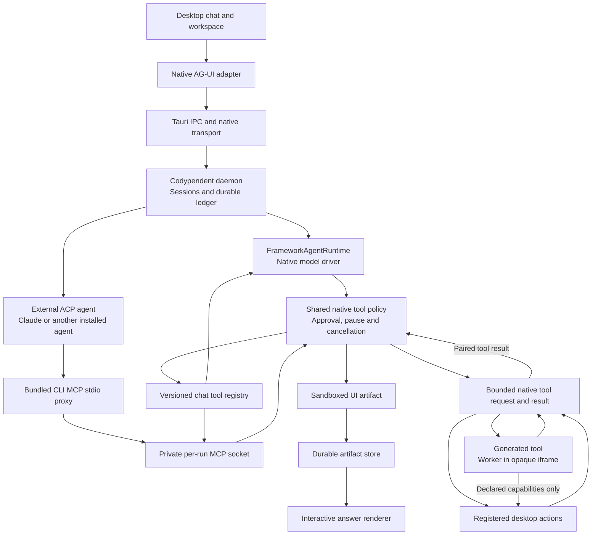

# Workspace uplift: native AG-UI and agent tools

Date: 19 October 2026. This records the workspace changes and focused checks. Packaged native acceptance passed with installed Codex and a real Ollama cloud model; the complete agent/model matrix and remaining provider outcomes are recorded in [Real agent acceptance](2026-10-19-real-agent-acceptance.md).

## Workspace and page experience

The desktop uses the Fold identity and a shared workspace shell, with clearer chat navigation, a repository/model context bar and a composer that keeps the next action in view. Secondary workspace tools load when opened. The product retains Codypendent's councils, shared memory, workflows, extensions, task board and repository controls.

Shared page, section and empty-state primitives give the workspace pages consistent spacing, readable headings and controls. All chats, Inbox, Usage, Skills, Documents, Extensions, Memory, Context, Checkpoints, Workflows, Task board, Blackboard, Edges, repository selection, councils, modes and API keys received task-oriented labels and page treatment. Empty, loading, unavailable and failed states remain distinct, with retry or creation actions where supported. Optional JSON, existing workflow runs, council round settings and typed repository paths are disclosed on demand. Document editing stacks at narrower widths.

The task board opens for the selected repository before a chat exists. A separate authenticated internal session owns its live subscription and mutations, so opening the board does not create a visible conversation or replace the active chat. Missing repository selection offers a repository action; creation stays disabled until the board is loaded. Old connection responses cannot replace a newer board.

## Startup and model discovery

Opening the native desktop connects to the local workspace service and starts it when needed. Connection progress appears while startup is pending; offline recovery appears after a failed connection. Background retries preserve the recovery action and focus. The browser preview explains when a native bridge is unavailable.

The app starts model discovery automatically. It checks installed supported ACP agents with a bounded handshake and reads actual model lists from supported running loopback servers and credentialed hosted providers. Hosted discovery resolves existing credentials and lists available models; it does not generate a response, install software or initiate a sign-in. Local endpoint discovery disables proxies and redirects, limits response size and excludes confirmed non-chat model capabilities. Agent sign-in remains managed by the installed agent. Automatic ACP defaults use the installed agent's own model choice; successful current metadata can repair a retired selector. Startup can select a confirmed available default when the saved route is unavailable, while manual rescans preserve the saved choice. A choice made during scanning is preserved. Existing names, credentials and unrelated configuration sections remain intact; a profile is removed only when complete current metadata disproves it. Newly detected models become available without repeating setup. Models and Providers offer a manual rescan and expandable detection details.

## Architecture

The desktop keeps the existing Codypendent daemon, durable sessions, model selection, worktrees, policies, approvals and artifact store. The AG-UI client projects that state into text, tool, run and activity events. It does not own another model loop or a separate conversation database.

The reference read before implementation was the local `aoo-copilotkit-research/OpenIntelligentUI` source, particularly its sandbox bridge and generated UI renderer, together with CopilotKit's tool-result continuation implementation. The adopted pieces are isolated generated UI, declared host functions, AG-UI run/tool/state events and explicit tool results. A frontend result completes the actual Codypendent tool call; it is not inserted as a pretend user prompt or steering message.

## Native IPC contract

Commands are implemented in `apps/desktop/src-tauri/src/desktop_tools.rs` and registered by the native bridge. Session IDs are typed UUIDs. JSON field names use camel case.

| Command | Arguments | Result |
| --- | --- | --- |
| `desktop_tools_publish` | `sessionId`, bounded `context`, host `tools` | Publishes the active desktop capability lease |
| `desktop_tools_pending` | `sessionId` | Atomically claims and returns one pending call, or `null` |
| `desktop_tools_resolve` | `sessionId`, `callId`, one `result` or `error` | Completes that call once |
| `desktop_tools_list` | `sessionId` | Saved generated tools for this chat |
| `desktop_tools_remove` | `sessionId`, `name`, `expectedVersion` | Deletes the matching version; stale versions fail |

A tool definition contains `name`, `description`, object JSON Schema `parameters`, optional `functionBody`, declared `capabilities`, and `version`. Host tool names begin `desktop.`; generated tool names begin `desktop.custom.`. A pending call carries `callId`, authoritative `sessionId` and `runId`, `name`, `args`, the captured definition, and `expiresAt`.

The renderer renews its lease every 15 seconds. A lease expires after 45 seconds. Calls have a 30-second result deadline. Requests, claims and results are private local records, published atomically. A second renderer cannot claim an already claimed call; a second result cannot replace an earlier result. Cancellation removes the call's records. A renderer that disappears after claiming an operation does not cause that operation to be replayed automatically.

Context publication permits only flat presentation fields: view, appearance, repository, session/run IDs, active/open files, selected model, mode, draft length and title. It excludes draft contents, authentication/configuration objects and arbitrary nested values. Tool results can include requested application data, including an explicitly requested draft; they enter the normal artifact and untrusted-evidence path.

## Model-facing tools

Four entry points supplement the published host tools:

- `generateSandboxedUi` accepts the reference fields in order: `initialHeight`, `placeholderMessages`, `css`, `html`, `jsFunctions`, `jsExpressions`. Its completed artifact has `type: "open-generative-ui"`. HTML is a string. The artifact uses `application/vnd.codypendent.desktop-tool+json` and is referenced by the durable `ToolCompleted` event.
- `desktop.defineTool` creates or updates a named sandbox function, schema and capability declaration. Updating increments its version. New definitions are reloaded for the next model request rather than waiting for another chat.
- `desktop.manageTools` lists saved source/schemas/capabilities/versions or deletes a generated tool. The user-facing inventory uses the version-guarded native list/remove commands.
- `desktop.executeTool` accepts a saved generated tool name and argument object. It provides a stable entry point when an ACP client cannot refresh its advertised tool list, retaining the same source/version/capability approval checks.

The initial host catalog has thirteen actions: read workspace context, navigate, focus the composer, read or prepare an unsent draft, change appearance, search chats, list models/providers/skills/documents/memory, and open a file through the existing editor handoff. These are adapters over application behaviour. Generated tools receive `args` and may call `await host.call(name, args)` only for explicitly declared host tools. They cannot acquire another capability by naming it in generated code.

Every native desktop tool call uses the existing `McpToolCall` policy path for the `desktop` server. It observes denial, explicit approval, pause and cancellation before execution. Generated tool calls also authorise each declared host capability through that same gate. The approval binds the full generated source, version, capabilities and invocation arguments; changing or deleting that definition after approval prevents dispatch. The sandbox also validates each nested host call's actual arguments.

The existing desktop approval renderer supports `McpToolCall`. It displays the complete proposed action as scrollable JSON, including canonical argument text and generated source; it does not truncate the source before review. The policy path currently offers these tools in Build mode, consistent with its command permission overlay.

Tool input, source, schema and result sizes are bounded. Maximums are 64 host tools, 64 generated tools per chat, 256 KiB per native record, 16 KiB published app context, 64 KiB function source, 128 KiB generated HTML, schema nesting of 12, and a 512 KiB MCP message. Generated tool workers have a five-second execution deadline and a maximum of 32 delegated host calls. Generated widgets render in separate sandboxed iframes and remain interactive after rendering; the worker deadline does not apply to a widget. Unsupported JSON Schema keywords or malformed keyword types are rejected before registration and rechecked when persisted definitions are read.

Generated tool definitions and versions are saved per chat and advertised again when that chat is reopened. Completed interactive UI artifacts restore from the durable transcript. The Agent tools page lists the host capabilities in plain language and supports reviewing or removing a saved custom tool; source, schemas and instructions remain inside details. A chat change discards late list/removal responses. Widget payloads validate optional fields before mounting, and each result resets its own height, loading and error state.

Packaged WebKit uses a dedicated `cody-sandbox://localhost/` document, served by the native URI-scheme handler. Its response has its own restrictive CSP, allowing inline/blob execution only inside the sandbox, blob workers and inline styles; network, form submissions and base URLs are blocked. Native iframe URLs use Tauri's `convertFileSrc` platform helper; the parent retains its script policy and adds only the sandbox scheme and its fixed HTTP/HTTPS aliases to `frame-src`. The bootstrap accepts one bounded initialization message from its parent; the renderer validates the child's window before sending it. Both iframe and response sandboxing permit scripts without a shared origin. Only the fixed root document can be requested; the handler reads no files or dynamic URL parameters. Installed Tauri core and Wry sources confirm that native API initialization and the invoke key are injected into the main frame only.

## ACP and hosted providers

Before an ACP session starts, the executor creates a private, source-bound per-run MCP server when a desktop lease is available. It passes the bundled matching CLI's hidden `__desktop_tools_mcp --socket ...` proxy through the existing ACP `mcpServers` contract. The proxy forwards stdio; the daemon retains the policy context, approval broker, run cancellation token, artifact store and tool execution. Socket lifetime follows the ACP run.

The MCP server exposes the same current schemas, emits a list-change notification after tool calls, and returns results to the external agent's actual MCP call. An attempt to call an unadvertised native tool such as `shell.run` is rejected. This bridge introduces no additional agent/model runtime.

The installed `agent-framework-openai` 0.2.0 transport forwards function names unchanged. Codypendent therefore adapts canonical dotted names at the model/MCP transport boundary. Already valid names remain unchanged; invalid or long names receive a stable readable ASCII alias with a SHA-256 suffix, at most 61 characters. Definitions and structured history use the same alias; returned parallel calls are restored to canonical names before policy evaluation or journalling. Descriptions retain `[native tool: canonical.name]` for identification.

## Extension view continuity

The desktop's existing controller connection is authorised to host remote UI. Its capabilities contract now survives view remounts: the daemon returns the existing capability selection and authorised document baseline when a renderer sends the same contract with a new message ID. A changed viewport is accepted without restarting extension workers. Reusing a message ID with a changed payload or changing the immutable capabilities contract still fails.

An extension rail appears when it has a mounted surface or an actionable contribution error. An empty session no longer reserves space for a `Live Extensions (0)` heading or an unrelated host-level connection error. A failed published document still exposes its recovery controls.

## Verification

Focused checks and acceptance run locally; filter counts below describe separate runs and can overlap:

| Check | Result |
| --- | --- |
| Focused runtime `desktop_` tests, including atomic claims and stale-source refusal | 7 passed, 0 failed, 0.14 seconds of test execution |
| Existing runtime `mcp_` regression checks | 11 passed, 0 failed, 0.03 seconds of test execution |
| CLI binary compile check including ACP executor and hidden proxy | Passed |
| Runtime library Clippy with warnings denied | Passed |
| Wire-name and existing tool-name overlay checks | 5 passed, 0 failed, 0.01 seconds of test execution |
| Daemon renderer remount, baseline and bounded replay checks | 4 passed, 0 failed, 0.01 seconds of test execution |
| Desktop remote UI delivery and empty/error visibility checks | 7 passed, 0 failed, 2.27 seconds |
| Native sandbox response policy and URL/method allowlist checks | 2 passed, 0 failed |
| Native launcher checks | 12 passed, 0 failed |
| Absent/refused daemon-socket classification | 2 passed, 0 failed |
| Installed-agent registry checks | 15 passed, 0 failed |
| Cancelled ACP discovery handshake | 1 passed, 0 failed |
| Prepared first-chat objective checks | 2 passed, 0 failed |
| Native model discovery checks | 10 passed, 0 failed; 1 live-machine check ignored |
| Native model readiness/key projection and duplicate-alias checks | 13 passed, 0 failed |
| Discovery, readiness and onboarding frontend checks | 3 focused files, 10 passed, 0 failed |
| Isolated installed-agent/local-server discovery | Passed: installed Codex, Copilot and OpenCode agents and a running Ollama server detected; no prompts, generation or installation |
| Shared page and knowledge/workflow surface checks | 9 focused files, 57 passed, 0 failed |
| Task-board readiness and reconnect checks | 2 focused files, 6 passed, 0 failed |
| Native board subscription without a visible chat | 1 passed, 0 failed; separate internal session, live updates, mutations and cleanup |
| Native AG-UI adapter and interactive/tool inventory surfaces | 2 focused files, 26 passed, 0 failed |
| Desktop TypeScript check after page/board changes | Passed |
| Packaged native first-turn generated UI and custom tool execution | Passed with isolated local provider fixture: generated UI, saved definition, refreshed tool advertisement on the next model request, four policy approvals and successful generated Worker execution returning actual workspace data to the same tool call |
| Packaged native restored interactive result | Passed at `tauri://localhost` with `cody-sandbox://localhost/`: restored saved widget and clicked Add one, changing 0 to 1 |
| Packaged native Agent tools inventory at 880 × 650 | Passed: inventory remains scrollable |

The focused tests cover dynamic schema advertisement and artifact creation, matching session/run results, duplicate replies, cancellation cleanup, stale desktop leases, unsupported/malformed schemas, capability rejection, persistent versions, stale-source refusal, MCP schema listing, rejection of foreign tools and preservation of the native approval gate. Frontend checks cover live run correlation and lifecycle, disposal/reuse, stale chat/artifact responses, invalid widgets and the native sandbox ready/init handshake, including wrong-frame and wrong-token rejection. Packaged acceptance confirms the fixture's first-turn continuation and restored widget interaction; subsequent real Codex and Ollama native runs and the broader model matrix are recorded in [Real agent acceptance](2026-10-19-real-agent-acceptance.md).

## Follow-up: readable models and simpler workspace controls

Model names now use a shared presentation formatter in the picker, composer, recovery messages, councils, provider settings and model analytics. Canonical coordinates remain unchanged for routing and persistence. Provider suffixes keep identical OpenCode/Cline models distinguishable. Raw model IDs, endpoints, readiness internals and credential details sit under closed Connection details; unverified badges and unknown context placeholders no longer dominate the list.

The entire Your workspace section is an accessible disclosure with saved state, allowing recent chats to use the released space. Native acceptance verified collapse across page changes and app restart. Approval cards now summarise purpose and workspace access, including old ACP/MCP envelopes and nested generated helpers; source, payload and internal policy reasons stay in closed disclosures. Actual Python definition, execution and capability approvals passed in the packaged app with a real model.

Focused UI approval/navigation checks passed 56 cases, with a final approval-only rerun of 12 cases after the last presentation change. Model presentation passed 3 cases after provider-route disambiguation. TypeScript and production frontend builds passed. New native screenshots are under `target/monty-assessment-2026-10-19/proof/`. See [Monty sandbox acceptance](2026-10-19-monty-sandbox.md) and [provider coverage](2026-10-19-provider-coverage.md) for the distinct execution and integration results.

The final complete `/Applications/Codypendent.app` update passed bundle verification, matching executable hashes, application registration and the CLI’s idle-guard daemon restart. The original `jev-investigation` repository reconnected automatically. The installed app visibly showed the new model names, closed connection details, discovered ZCode GLM and Amp choices, the readable GitHub Copilot default and a collapsible Your workspace section. It was left connected on a fresh chat. The preceding full installation is backed up under `target/monty-assessment-2026-10-19/previous-installed/`; final installation hashes and screenshots are in the same assessment directory.

A final installed-agent fallback regression passed 1/1 and the native app was rebuilt and refreshed again. Gemini Default then appeared automatically despite the background handshake deadline; friendly-name search found it with connection details closed. The collapsed sidebar persisted through this installed-app restart. Evidence: `target/monty-assessment-2026-10-19/proof/installed-gemini-auto-detected.png`.

## Follow-up: Google account reuse, knowledge graph and councils

The later [authentication recovery checks](2026-10-19-auth-recovery.md) supersede the earlier Claude/Gemini/Antigravity failures: all three completed real desktop-tool runs. Kimi has no usable cached CLI token on this machine. The [knowledge graph and council report](2026-10-19-knowledge-councils.md) records the interactive real-code map, sidebar separation, redesigned council flow, navigation fixes and actual completed council acceptance.
